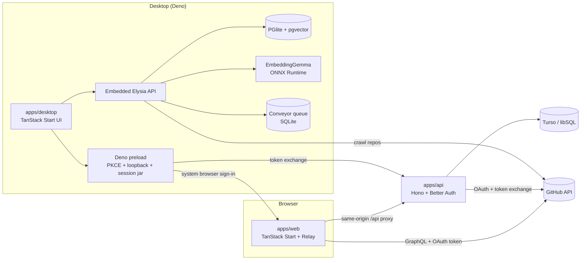

# Tangerine

**A faster, quieter GitHub dashboard — plus a local-first RAG lab for your starred repos.**

Tangerine is a TypeScript monorepo that explores the same product from three angles: a browser dashboard that makes GitHub pleasant to browse, a Hono API that owns identity and secrets, and a native desktop app that indexes and embeds your repos entirely on your machine.

Built by [Dennis Waweru](https://github.com/tigawanna).

---

## What it does

### Web dashboard (`apps/web`)

A Relay-powered SPA for people who live in GitHub but hate the full-page reload tax.

- Browse any user or organisation: profile, repositories, stars, followers, following.
- Open a repo to read its README, branches, commits, and settings without losing your place.
- Keyboard-first GitHub search with a visual query editor (language, stars, owner, type).
- Bulk actions GitHub makes painful: delete many repos at once, follow back a whole list.
- Fast tab/filter navigation backed by URL state, with data preloaded before the route renders.
- A polished public landing page with prerendered SEO, JSON-LD, and dynamic OG images.

### Desktop app (`apps/desktop`)

A local-first research tool for your GitHub corpus.

- Sign in with GitHub through the system browser; the session lives on disk, not in the webview.
- Crawl your owned or starred repos into an embedded Postgres database (PGlite + pgvector).
- Extract READMEs, manifests, languages, and monorepo structure with the shared spelunk pipeline.
- Embed repos on-device with **EmbeddingGemma** on ONNX Runtime.
- Ask for "graph databases in Rust" and get a semantic, not keyword, result.
- Watch long crawls and model downloads stream progress into the UI without blocking navigation.

### API (`apps/api`)

The trust boundary. GitHub OAuth, sessions, roles, API keys, and desktop token handoff live here — never in the clients.

---

## Architecture



Two products, one codebase, shared contracts:

| Surface | Rendering                                                  | Data                                                   | Auth                                    |
| ------- | ---------------------------------------------------------- | ------------------------------------------------------ | --------------------------------------- |
| Web     | TanStack Start; landing prerendered, dashboard client-only | Relay → GitHub GraphQL; TanStack Query; typed Hono RPC | First-party cookies on the web origin   |
| Desktop | TanStack Start inside Deno Desktop                         | Local Elysia API → PGlite / pgvector                   | Session jar written by the Deno preload |
| API     | Hono on Node / Vercel                                      | Drizzle → Turso or local libSQL                        | Better Auth (GitHub only)               |

---

## Backend: `apps/api`

The API is intentionally small. It is the one place that holds OAuth secrets, issues sessions, and talks to the database. Frontends are clients.

```
apps/api/src
├── app.ts             # Hono app: base path, CORS, logging, routes
├── lib/auth.ts        # Better Auth instance (GitHub + Turso)
├── db/                # Drizzle, Turso HTTP client, local libSQL client
├── routes/            # home, viewer, admin, debug
├── env.ts             # Zod-validated environment
├── index.ts           # local Node server
└── vercel-entry.ts    # Vercel Node launcher
```

### Authentication

Better Auth with **GitHub OAuth only** — no email/password anywhere.

- Sessions and accounts are stored through the Drizzle adapter — Turso in production, local libSQL in development.
- Plugins: `openAPI`, `electron` (desktop handoff), `apiKey`, `bearer`, and `admin`.
- Roles are `admin` / `user`; any account whose GitHub email matches `ADMIN_EMAIL` is promoted to admin.
- The GitHub profile's login is copied onto the user as `githubUsername` so the web app can route straight to `/$user` after sign-in.
- Trusted origins, CORS, and rate limiting (100 requests/minute) are configured centrally.

The important rule: `BETTER_AUTH_URL` is the **public web origin**, not the API hostname. The web app proxies `/api/*` to this API, so OAuth state cookies stay first-party. The GitHub callback is therefore:

```
{BETTER_AUTH_URL}/api/auth/callback/github
```

### Data layer

- Drizzle ORM with a single schema shared by Turso and local development.
- `db/client.ts` picks the right driver: remote Turso over HTTP, or a local `file:` database.
- Auth tables are generated with `pnpm --filter api auth:gen`; migrations are generated, not hand-written.
- `/debug/db` is a secret-gated health check that pings the same client the app uses.
- `/admin/users` is a paginated, searchable, sortable user listing — a small example of typed Drizzle queries at the edge.

### Typed client contract

The Hono app exports its type, and the web app imports it through a TypeScript path alias:

```ts
import type { AppType } from "@api/app";
import { hc } from "hono/client";

export const honoClient = hc<AppType>(clientEnv.VITE_APP_URL, {
  init: { credentials: "include" },
});
```

Using `import type` means the server entry never ends up in the browser bundle, but every route, input, and response is still checked at compile time.

### Observability

Every app writes structured wide events with [evlog](https://evlog.dev). In development they land in one shared NDJSON sink at `.evlog/logs/YYYY-MM-DD.jsonl` with distinct services:

- `tangerine-api`
- `tangerine-web`
- `tangerine-desktop`
- `tangerine-desktop-runtime`

Auth and desktop handoff traffic is always kept, which makes OAuth debugging much less painful.

### Deploying the API

Vercel's Hono preset transpiles files individually and breaks monorepo imports, so `apps/api` ships as a single packed Node ESM function using Vite+ `vp pack` and the Build Output API v3.

One non-obvious setting matters a lot:

```json
{ "shouldAddHelpers": false }
```

Vercel's Node helpers consume `req.body`, which leaves Better Auth hanging forever on `request.json()` for `POST /api/auth/*`. GETs still work, so the symptom looks like "sign-in redirects forever" rather than a body-parsing bug.

Full write-up: [`docs/vercel-deploy.md`](docs/vercel-deploy.md).

---

## Frontend: `apps/web`

TanStack Start, React 19, Relay, Tailwind v4, and shadcn components, stitched together with a strict route and data-loading model.

### Rendering strategy

- The public landing page is prerendered at build time for SEO and fast first paint.
- `/_dashboard` is `ssr: false` — it is a signed-in SPA whose data source is GitHub GraphQL, so there is nothing useful to server-render.
- Route guards run in `beforeLoad`, which means auth and redirects happen before a component ever mounts.

```
src/routes
├── index.tsx                  # public landing
├── og.tsx                     # dynamic OG image endpoint
├── auth/                      # sign-in + desktop loopback handoff
└── _dashboard/
    ├── layout.tsx             # session gate + stable Relay environment
    ├── viewer/index.tsx       # post-login redirect to /$user
    └── $user/
        ├── layout.tsx         # profile query + tab/filter search schema
        ├── index.tsx          # profile hub: repos, stars, followers, following
        ├── repos/$repo/       # repo detail, README, branches, commits
        └── search/            # GitHub search with visual filters
```

### Data loading with Relay

The dashboard talks to GitHub GraphQL directly from the browser using the signed-in user's OAuth token.

- A single `Environment` is created per tab and reused across navigations. Creating one per route breaks `loadQuery` + `usePreloadedQuery` references.
- Parent routes `loadQuery`; children read with `usePreloadedQuery`.
- Pagination uses Relay connections, so lists keep their identity while more pages load.
- Mutations (star, follow, delete, repo settings) update the Relay store where possible and refresh affected lists otherwise, so the UI stays consistent without refetching everything.
- Search and filter chrome sits **outside** Suspense boundaries. Otherwise changing a tab or query re-suspends the whole page and the controls flicker away.

### URL state without redirect loops

Filters and tabs live in the URL, but the schema is deliberately flat and mostly optional. Defaults are applied in a resolver after validation, not with Zod defaults. Rewriting the URL during `validateSearch` is a quick way to get TanStack Router stuck in a redirect loop; this structure avoids it. `Activity` keeps inactive tab panels mounted so switching tabs is instant.

### Auth on the web

- `authClient` points at the **web** origin with `basePath: "/api/auth"` and `credentials: "include"`.
- The Nitro/Vercel config proxies `/api/**` to the API host. That single decision is what keeps cookies first-party on split `*.vercel.app` deployments.
- The GitHub token is fetched from the API by account id, cached in memory, and shared by the Relay network layer.
- The GitHub login is resolved from the session first, falling back to `GET /user`, so routing never depends on a field that might be missing.

Desktop clients reuse the same `/auth` page with PKCE parameters and a `loopback` callback — the browser is the sign-in surface, the native runtime owns the session.

### UI details

- shadcn components for structure, DaisyUI only for theme tokens and small primitives.
- Theme tokens throughout; no hardcoded colours.
- React 19 Compiler, so no `useMemo` / `useCallback` / `memo` noise.
- View transitions, keyboard shortcuts (`⌘K`), responsive layouts, and `data-test` hooks on interactive UI.
- Dynamic OG images are rendered on demand with Takumi at `/og?title=…&description=…`.
- The landing page includes real SEO metadata and `WebApplication` structured data.

---

## Desktop: `apps/desktop`

A TanStack Start app packaged by [`deno desktop`](https://docs.deno.com/runtime/desktop/) into a native window. Server code runs directly in the Deno process — no main/renderer IPC split.

- **Auth:** the Deno preload generates PKCE, starts a loopback listener, opens the system browser, and stores the resulting session jar under `~/.config/tangerine-desktop/`.
- **Local API:** an embedded Elysia app mounted at `/api/elysia/*` handles enrichment, search, chat, model management, and system metrics.
- **Local database:** PGlite (embedded Postgres) with pgvector, live queries, and Drizzle migrations.
- **Jobs:** Conveyor with a SQLite store — one job per repo, deduplicated by GitHub id, retries with exponential backoff, survives restarts. Star lists are crawled page by page (up to 100 per page) with resume cursors, and workers pull batches of 10 so a single bad repo can't fail a whole run.
- **Rate limits:** the list crawl and the worker both back off on GitHub 429s (exponential, capped), pause the worker for 60s, and reschedule the failed jobs instead of dropping them. Status is derived ("done" only when the crawl has settled and nothing is waiting) so the UI can't get stuck mid-run.
- **Embeddings:** a shared EmbeddingGemma instance on ONNX Runtime, with quantisation switching, download progress, and cache inspection.
- **Progress:** in-process pub/sub over SSE streams crawl and embed activity into the UI.

The thesis behind it: **ask "that Rust crate for terminal UIs with a flexbox layout" and get the right starred repo back**, even if you starred it three years ago and forgot the name. The pipeline is fetch → embed → store → retrieve, and the design rules are:

- **Stay on-device.** Stars, READMEs, and vectors never leave the machine. The only network calls are to GitHub (the source of truth) and to `apps/api` for sign-in.
- **Local RAG, not a SaaS.** No hosted vector database, no hosted embedding API, no second model for generation. The answer is a ranked list of your own repos — obviously correct, because every result is a real star.
- **Visible progress.** Indexing takes minutes on purpose, so the UI streams "embedding facebook/react" and "42 done, 1 failed" instead of a spinner.
- **Retrieval only, for now.** Filters, hybrid ranking, chunked READMEs, HNSW, and optional local generation are the natural next steps.

Pipeline:

```
star list ──► queue (SQLite) ──► fetch README + manifests
                                      │
                                      ▼
                              EmbeddingGemma (ONNX)
                                      │
                                      ▼
                              PGlite + pgvector
                                      │
                     semantic query ──┴──► ranked repos
```

The full story is written up as a five-part series:

| #   | Article                                                                                                                                             |
| --- | --------------------------------------------------------------------------------------------------------------------------------------------------- |
| 1   | [Deno Desktop the basics](https://www.tigawanna.vip/blogs/bulding-a-local-rag-tool-with-deno-desktop-31d4)                                          |
| 2   | [Deno desktop Better Auth integration](https://www.tigawanna.vip/blogs/deno-desktop-better-auth-intergration-32ni)                                  |
| 3   | [Queues and workflows with Conveyor](https://www.tigawanna.vip/blogs/queues-and-workflows-with-conveyor-48kk)                                       |
| 4   | [Live activity bus (Elysia SSE + pub/sub)](https://www.tigawanna.vip/blogs/live-activity-bus-elysia-sse-pubsub-powered-by-nodejs-event-emitter-ojk) |
| 5   | [Setting up vector search for GitHub starred repos](https://www.tigawanna.vip/blogs/setting-up-vector-search-for-github-starred-repos-6f5)          |

The same material lives in-repo as [`apps/desktop/docs/local-rag/`](apps/desktop/docs/local-rag/README.md).

---

## Shared packages

| Package                   | Responsibility                                                                                                               |
| ------------------------- | ---------------------------------------------------------------------------------------------------------------------------- |
| `@repo/auth`              | Better Auth factories, env schema, roles, GitHub scopes, Electron/Deno protocol constants, CLI credential storage            |
| `@repo/github`            | Typed Octokit + GraphQL client, gql.tada queries, repo mutations, README/manifest **spelunk** pipeline (10 manifest parsers) |
| `@repo/gemma-embedding`   | EmbeddingGemma wrapper: singleton instance, dtype cache, download jobs, progress, node + web entry points                    |
| `@repo/ui`                | Shared UI primitives and the portfolio landing composition                                                                   |
| `@repo/site-constants`    | Personal site identity, links, and content constants                                                                         |
| `@repo/typescript-config` | Shared TypeScript base configs                                                                                               |

---

## Stack

| Layer         | Choices                                                                               |
| ------------- | ------------------------------------------------------------------------------------- |
| Language      | TypeScript everywhere, strict mode                                                    |
| Monorepo      | pnpm workspaces + Turborepo                                                           |
| Toolchain     | Vite+ (`vp`) — Vite, Rolldown, Vitest, Oxlint, Oxfmt, tsdown                          |
| Web           | TanStack Start / Router / Query, React 19, Relay, Tailwind v4, shadcn, DaisyUI tokens |
| API           | Hono, Better Auth, Drizzle, Turso / libSQL, Zod                                       |
| Desktop       | Deno Desktop, Elysia, PGlite + pgvector, Conveyor, ONNX Runtime, EmbeddingGemma       |
| Observability | evlog wide events → NDJSON                                                            |
| Deploy        | Vercel (web + API), packaged native desktop builds                                    |

---

## Getting started

### Prerequisites

- Node.js 20+
- pnpm 10
- Deno 2.9+ (desktop only)
- A GitHub OAuth app

### Install

```bash
pnpm install
```

### Environment

```bash
cp apps/api/.env.example apps/api/.env
cp apps/web/.env.example apps/web/.env
cp apps/desktop/.env.example apps/desktop/.env   # desktop only
```

Create a GitHub OAuth app with the callback:

```
http://localhost:3064/api/auth/callback/github
```

Then fill in `GITHUB_CLIENT_ID`, `GITHUB_CLIENT_SECRET`, and a `BETTER_AUTH_SECRET` in `apps/api/.env`. Keep `BETTER_AUTH_URL` and `VITE_APP_URL` pointed at the web origin (`:3064`), not the API.

### Run

| Command                          | What it starts                                 |
| -------------------------------- | ---------------------------------------------- |
| `pnpm dev:desktop:all`           | API + web + native desktop window              |
| `pnpm dev:web`                   | Web only (`:3064`) — API still needed for auth |
| `pnpm --filter api dev`          | API only (`:5000`)                             |
| `pnpm --filter desktop dev`      | Native desktop window (`:3070`)                |
| `pnpm --filter desktop dev:vite` | Desktop UI in a normal browser                 |

Ports: API `5000` · Web `3064` · Desktop `3070`.

### Useful commands

```bash
pnpm check-types        # TypeScript across the monorepo
pnpm quality            # Format + lint
pnpm --filter api db:migrate
pnpm --filter desktop db:setup
pnpm --filter web relay # regenerate Relay artifacts after GraphQL edits
```

### Health check

```bash
curl http://localhost:5000/api
curl http://localhost:3064/api          # through the same-origin proxy
```

---

## Deployment

Two Vercel projects, both rooted inside the monorepo:

| Project | Root       | Build                                               |
| ------- | ---------- | --------------------------------------------------- |
| Web     | `apps/web` | TanStack Start / Nitro, proxies `/api/*` to the API |
| API     | `apps/api` | `vp pack` → Build Output API v3, one Node function  |

Set `VITE_APP_URL` (public web URL) and `VITE_API_URL` (API upstream) on the web project. On the API, set `BETTER_AUTH_URL` to the **web** URL, plus Turso credentials and GitHub OAuth secrets. The GitHub callback remains `{BETTER_AUTH_URL}/api/auth/callback/github`.

Details and traps: [`docs/vercel-deploy.md`](docs/vercel-deploy.md) · [`docs/auth.md`](docs/auth.md) · [`docs/auth-redirects.md`](docs/auth-redirects.md).

---

## What was hard

The parts worth reading if you want the short version of what this project taught me:

- **OAuth across three runtimes.** Browser cookies, a Deno session jar, and a Vercel serverless API all have different rules. Solving it meant a same-origin proxy for the web, PKCE + loopback for the desktop, and keeping every secret on one server.
- **Serverless body streams.** A framework helper quietly consumed the request body and made Better Auth hang for 300 seconds. Finding that required reading the Vercel runtime config, not the app code.
- **Relay inside TanStack Router.** Preloading, stable environments, connections, and Suspense boundaries have to agree. The fix is architectural: controls stay mounted, only the data pane suspends.
- **Local AI that behaves like a product.** Model loading, quantisation, download progress, job queues, rate limits, retries, and SSE progress all have to survive a user closing the window.
- **Type safety end to end.** One Hono app type, one Drizzle schema, gql.tada-generated GitHub types, and shared workspace packages — without shipping server code to the browser.

---

## Documentation

| Doc                                                                                                         | Contents                                                  |
| ----------------------------------------------------------------------------------------------------------- | --------------------------------------------------------- |
| [`docs/auth.md`](docs/auth.md)                                                                              | Auth architecture across web, API, Deno Desktop, Electron |
| [`docs/auth-redirects.md`](docs/auth-redirects.md)                                                          | Copy-paste redirect/cookie cheat sheet                    |
| [`docs/vercel-deploy.md`](docs/vercel-deploy.md)                                                            | Hono packing, Turso, proxy, OAuth traps                   |
| [`docs/backstage-list-pattern.md`](docs/backstage-list-pattern.md)                                          | Search + pagination conventions for list screens          |
| [`docs/takumi.md`](docs/takumi.md)                                                                          | Dynamic OG images with Takumi in TanStack Start           |
| [`apps/desktop/docs/local-rag/`](apps/desktop/docs/local-rag/README.md)                                     | Five-chapter local RAG walkthrough                        |
| [Published article series](https://www.tigawanna.vip/blogs/bulding-a-local-rag-tool-with-deno-desktop-31d4) | The same five chapters as live posts on tigawanna.vip     |
| [`apps/web/README.md`](apps/web/README.md)                                                                  | Web app specifics                                         |
| [`apps/api/README.md`](apps/api/README.md)                                                                  | API specifics                                             |
| [`apps/desktop/README.md`](apps/desktop/README.md)                                                          | Desktop packaging, icons, and native shell                |

---

## Status

- Web dashboard: working end to end (auth, profiles, repos, stars, followers, search, bulk actions).
- Desktop RAG: crawl → enrich → embed → semantic search works locally.
- Next: bring natural-language search to the web dashboard and keep tightening the shared GitHub pipeline.

---

**Dennis Waweru** · [GitHub](https://github.com/tigawanna) · [LinkedIn](https://linkedin.com/in/dennis-kinuthia-waweru) · [Website](https://tigawanna-portfolio.vercel.app)
